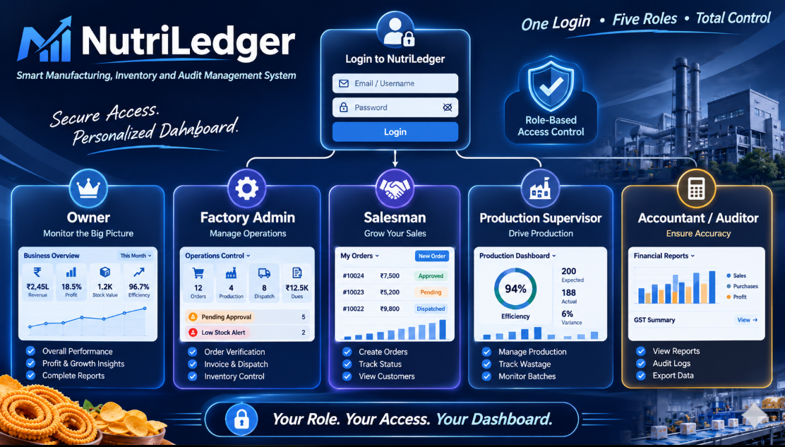

# NutriLedger

Smart Manufacturing, Inventory & Audit Management for packaged-food businesses.

NutriLedger connects sales orders, GST billing, purchasing, production and stock records in one role-aware web application. The repository has a React/Vite client and FastAPI API backed by PostgreSQL (SQLite is used only as a lightweight local/test option).

## Product preview




## Features implemented

- One common login with five database-assigned roles and role-specific dashboards.
- Argon2id password hashing (legacy PBKDF2 hashes are upgraded at next login), expiring JWTs in HttpOnly cookies, CSRF protection, logout revocation and login throttling.
- Owner, Factory Admin, Salesman, Production Supervisor and Accountant / Auditor permissions enforced by the API.
- Password reset/change workflows and administrator user management with account activation and login history.
- Manufacturing command-center dashboard with filtered revenue analytics, production performance, stock alerts, dispatch/receivable priorities and recent audit activity.
- Inventory intelligence with configurable reorder policies, historical usage/coverage estimates, reorder suggestions and batch/expiry visibility.
- Product/customer directories, assigned-customer sales scope and ledger-derived stock balances.
- Purchase receipts with weighted-average raw-material cost updates and optional batch/expiry tracking.
- BOM-driven production runs, actual-material issues, damaged pouch issues and yield/material variances.
- Order submission with stock warning, approval checks, GST invoicing, partial dispatch and payments.
- Invoice PDF download, GST/sales/production/receivables summaries and audit logs.
- Responsive enterprise interface using a dark-navy and royal-blue design system with separate Owner, Factory Admin, Sales, Production and Finance dashboards.
- PostgreSQL Docker Compose setup, Alembic migration entry point and automated benchmark tests.
- Optional Sri Lakshmi Foods demo dataset with a separate, registry-limited reset command.

The UI currently exposes the operational flows above, with report exports for sales, production, stock ledger and receivables.

### Dashboard command center

The Overview page uses the authenticated `/api/dashboard` response and database records for orders, production, invoices, stock movements, inventory lots and audit activity. Revenue analytics defaults to the latest 30 days and accepts `from_date` / `to_date` (`YYYY-MM-DD`) query parameters; ranges are limited to 366 days. The dashboard also compares expected and good production output for the latest completed runs and builds actionable attention items from current stock policies, pending order/dispatch work, unpaid invoices and near-expiry or expired lots.

### Smart inventory intelligence

The Inventory page derives on-hand balances from stock movements and shows 30-day average usage, estimated days remaining, suggested replenishment, reorder minimums and tracked lots. Admins can update a minimum-stock level and target coverage days; low-stock alerts are calculated from those policies and recent consumption. Purchase receipts may include a batch code and expiry date, and completed production creates a finished-goods batch using its run reference. Production issues and dispatches allocate from eligible lots by earliest expiry first; expired tracked quantities are excluded from issue/dispatch availability. Existing untracked opening balances remain ledger-compatible.

## Technology

- Frontend: React 18, Vite 6, Tailwind CSS 3, React Router, Axios, Lucide, Recharts.
- Backend: Python 3.11, FastAPI, SQLAlchemy 2, Pydantic, PyJWT.
- Database: PostgreSQL 16; SQLite for isolated automated tests.
- PDF: ReportLab.

## Repository layout

```text
backend/
  app/                 API, SQLAlchemy models, auth and business services
  migrations/          Alembic environment and versioned schema migrations
  tests/               Arithmetic and end-to-end benchmark tests
  seed.py              Development-only benchmark seed
frontend/
  src/                 React application, API client and styles
docker-compose.yml     PostgreSQL, API and web containers
DESIGN.md              Architecture and business calculation notes
```

## Run locally

### Deploy the full app on Render

The GitHub repository includes a Render Blueprint for the API, static frontend and PostgreSQL database. Use the [Render deployment setup](https://render.com/deploy?repo=https://github.com/rithika5656/Order-to-Audit-System), connect your GitHub account, and provide `INITIAL_OWNER_EMAIL` and a strong `INITIAL_OWNER_PASSWORD` when prompted. These values are used only to create the first Owner account and are not stored in the repository. The frontend and API are deployed together through the Blueprint, with HTTPS cookies and a generated JWT secret.

Render assigns the public application URL after the first deployment completes. The live URL cannot be listed until that service has been created in an authorized Render account. Free Render services may sleep when idle and free database availability/retention is subject to Render's current plan limits; use an appropriate paid plan for persistent production operation.

### Docker Compose (PostgreSQL)

1. Copy `.env.example` to `.env`. Use a unique `JWT_SECRET` and a strong local database password.
2. Run:

   ```powershell
   docker compose up --build -d
   docker compose exec api alembic -c alembic.ini upgrade head
   docker compose exec api python seed.py
   docker compose exec api python seed_roles.py
   ```

3. Open `http://localhost:8080`. API docs are at `http://localhost:8000/docs`.
4. To stop the services, run `docker compose down`. The named PostgreSQL volume is retained.

For production, disable demo seeding, set long random secrets, use TLS and a managed secrets provider, and review CORS and deployment policy. The bundled demo accounts are for local development only.

### Local development

Backend (from `backend`):

```powershell
python -m venv .venv
.\.venv\Scripts\Activate.ps1
pip install -r requirements.txt
$env:DATABASE_URL = "sqlite:///./nutriledger.db"
$env:JWT_SECRET = "local-only-change-this-secret"
alembic upgrade head
python seed.py
python seed_roles.py
uvicorn app.main:app --reload
```

### Sri Lakshmi Foods demo data

The benchmark fixture from `seed.py` remains independent. To add the Sri Lakshmi Foods demo company, first apply migrations and run its separate deterministic seeder:

```powershell
cd backend
$env:DEMO_MODE = "true"
alembic upgrade head
python seed_demo.py
```

The script creates 10 products, 15 materials, 8 customers, 10 suppliers, 5 demo users, 10 recipes, 35 orders, 18 production batches, 12 purchases, 28 invoices, 15 payments, 200+ stock ledger movements and 30+ audit activities. Every generated business record is marked `DEMO DATA` or registered under a dedicated demo batch key. It refuses to overwrite an existing company profile and is idempotent for a seeded batch. It generates unique, strong passwords and prints them only when creating the accounts; users must change them at first sign-in. Set `DEMO_SEED_PASSWORD` to provide a secure 12+ character password if needed. The legacy demo emails are `demo.admin@srilakshmifoods.example.test`, `demo.sales@srilakshmifoods.example.test`, `demo.production@srilakshmifoods.example.test`, `demo.accounts@srilakshmifoods.example.test` and `demo.owner@srilakshmifoods.example.test`.

### Five-role demo accounts

After applying migrations, run the dedicated idempotent account seeder:

```powershell
cd backend
$env:DEMO_MODE = "true"
python seed_roles.py
```

It creates the requested common-application accounts, generates a separate strong password for each new account, and prints each password once in the development terminal. Save those values securely; subsequent runs do not reset or reveal existing passwords. To set individual passwords before first creation, configure `DEMO_OWNER_PASSWORD`, `DEMO_FACTORY_ADMIN_PASSWORD`, `DEMO_SALESMAN_PASSWORD`, `DEMO_PRODUCTION_PASSWORD`, or `DEMO_AUDITOR_PASSWORD` with a strong 12+ character value.

| Dashboard / role | Demo username |
|---|---|
| Owner Command Center | `owner@nutriledger.demo` |
| Factory Administration Dashboard | `admin@nutriledger.demo` |
| Sales & Order Dashboard | `sales@nutriledger.demo` |
| Production Control Center | `production@nutriledger.demo` |
| Finance & Audit Dashboard | `auditor@nutriledger.demo` |

Users share one login page. The role stored on the account determines navigation and the post-login route: `/owner/dashboard`, `/admin/dashboard`, `/sales/dashboard`, `/production/dashboard`, or `/accountant/dashboard`. Sales accounts see only assigned customers and their own orders; accountancy is read-only. Factory Admins can create operational accounts, while only Owners may assign Owner or Factory Admin roles.

The dashboard, customer directory, supplier directory and order register read their values from database queries. Order approval/fulfilment and payment are shown as separate states, and stock balances continue to come from signed ledger movements.

Reset is a separate, explicitly confirmed operation. It only targets rows registered by this demo seeder, requires `DEMO_MODE=true`, and stops if unregistered business, inventory or audit records depend on demo records:

```powershell
$env:DEMO_MODE = "true"
python reset_demo.py --confirm
```

Do not run either demo command against a production database. The reset command never deletes shared role records or unregistered user/business records. The benchmark seed and its mandatory Murukku values are not changed by this demo data.

Frontend (from `frontend`):

```powershell
npm install
npm run dev
```

Vite runs at `http://localhost:5173`. Set `VITE_API_URL` if the API is hosted elsewhere. To use PostgreSQL locally, set `DATABASE_URL` to a `postgresql+psycopg://...` connection URL before running Alembic or Uvicorn.

## Password reset and deployment

In `DEMO_MODE=true`, password-reset requests return a one-time development token to the login page when SMTP is not configured. In production, configure `SMTP_HOST`, `SMTP_PORT`, `SMTP_FROM`, and optionally `SMTP_USERNAME`, `SMTP_PASSWORD`, and `SMTP_USE_TLS`; reset instructions are emailed and tokens expire after one hour. The production API does not expose reset tokens in responses.

For production, set `DEMO_MODE=false`, a unique random `JWT_SECRET` of at least 32 characters, `COOKIE_SECURE=true`, trusted `CORS_ORIGINS`, and SMTP settings. Serve the frontend and API over HTTPS. Demo account passwords are never embedded in frontend code or checked into documentation.

## Benchmark data and verification

`python seed.py` creates the benchmark opening inventory, Murukku 200 g product/BOM, Retailer A (Tamil Nadu), Distributor B (Karnataka), sample supplier and five legacy development users with randomly generated one-time passwords. `python seed_roles.py` creates the five requested `@nutriledger.demo` accounts. Both seeders refuse to run when `DEMO_MODE=false`. Then run one purchase (60 kg flour at ₹45/kg), one production batch (200 planned, 188 good, actual oil 10.5 L, damaged 6 pouches, 9 cartons), one 150-packet Retailer A order/invoice/dispatch, a ₹4,000 payment, and finally a 120-packet Distributor B order.

Expected ledger results:

| Check | Expected |
|---|---:|
| Flour / oil / pouches closing | 120 kg / 19.5 L / 306 pieces |
| Cartons closing | 21 pieces |
| Finished goods after production / dispatch | 238 / 88 packets |
| Yield / oil consumption variance | -6% / +5% |
| Taxable / CGST / SGST / invoice total | ₹7,500 / ₹187.50 / ₹187.50 / ₹7,875 |
| Retailer A outstanding / Distributor B shortage | ₹3,875 / 32 packets |

Automated test runs the API workflow against an isolated in-memory SQLite database:

```powershell
cd backend
python -m pytest -q
```

## Security and operations notes

- Passwords are Argon2id-hashed and never stored in clear text. Existing PBKDF2 credentials are verified and upgraded to Argon2id after a successful login.
- JWTs expire, are stored in HttpOnly cookies, and are checked against the user's token version. Logout, password changes, password resets, role changes and account deactivation revoke existing sessions. Cookie-authenticated writes require a CSRF token.
- Login attempts are throttled, inactive accounts cannot authenticate, and password reset uses one-time hashed tokens. Demo reset tokens are only returned while `DEMO_MODE=true`.
- API role checks and salesperson data scoping are enforced server-side; frontend route guards are an additional UX layer, not the security boundary.
- Important posted transactions create audit rows. Inventory is derived from append-only source-referenced movements; application endpoints do not expose direct stock balance editing.
- Monetary calculations use Python `Decimal` and SQL `NUMERIC` columns.
- Orders can be submitted even when stock is short so the shortage is visible; approval and dispatch reject insufficient inventory.
- Invoice records are unique per order. Dispatch and payment references are unique and duplicate purchase/production references are rejected.
- Production material cost uses a weighted-average rate snapshot at issue time. Labor and utility expenses can be recorded against a run and are allocated over its good output for the cost-per-packet report.
- Schema `create_all` is currently retained for convenient development startup; use Alembic as the deployment schema authority.

## Remaining product limitations

- Supplier editing, complete customer/product maintenance fields, credit notes/cancellations, and configurable invoice legal metadata are not yet available.
- Partial-dispatch and payment entry still use simple browser prompts; reports cover the principal business registers rather than every possible filtered analytics view.
- SMTP delivery must be configured for production password reset; demo token display is development-only.
- There is no refresh-token flow; sessions use expiring access tokens and server-side version revocation.

See [DESIGN.md](./DESIGN.md) for stock ledger, BOM, tax and costing assumptions.
